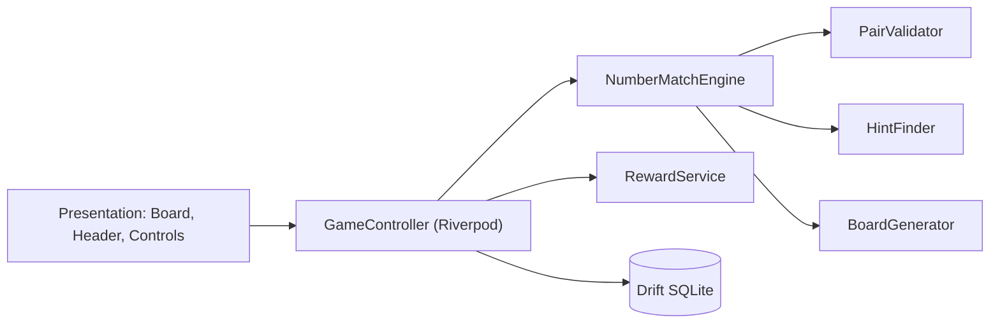

# Number Match — Complete Game Guide

> **Türkçe sürüm:** [GAME_GUIDE.tr.md](GAME_GUIDE.tr.md)

This document provides a comprehensive overview of **how to play, game mechanics & logic, available modes, scoring/economy rules, and how to build & run** the game. For the high-level technical overview, see [README.md](../README.md); for the formal specification, see [GAME_RULES.md](GAME_RULES.md); for architecture details, see [ARCHITECTURE.md](ARCHITECTURE.md).

> Values are sourced directly from runtime code (`lib/core/constants/game_constants.dart`, `lib/domain/engine/*`).

---

## 1. What is the Game?

Number Match is a tactical logic puzzle played on a dynamic **9-column grid** populated with digits from 1 to 9. The objective is to clear pairs of numbers following adjacency and sum/value rules until the board is completely emptied. It is built in Flutter, targeting Android and iOS with an offline-first architecture.

**Goal:** Clear every number on the board (Victory) while accumulating the highest possible score and combo multiplier.

---

## 2. How to Play

### 2.1 Matching Rules
Two numbers match if **either** condition holds:

| Rule | Examples |
| :-- | :-- |
| Values are **identical** ($v_1 = v_2$) | 3–3, 7–7, 9–9 |
| Values **sum to 10** ($v_1 + v_2 = 10$) | 1–9, 2–8, 3–7, 4–6, 5–5 |

A cell cannot match with itself. Cleared/empty cells cannot be tapped.

### 2.2 Spatial Line-of-Sight Rules
Two matching numbers must satisfy **at least one** of these spatial alignments, with all intermediate cells cleared (empty):

1. **Consecutive in Reading Order:** Reading left-to-right, top-to-bottom. If cell A is the last active number of row $R$ and cell B is the first active number of row $R+1$ (wrapping across rows), they are considered consecutive.
2. **Same Row:** Both cells lie in the same row with only empty cells in between.
3. **Same Column:** Both cells lie in the same column with only empty cells in between.
4. **Diagonal ($45^\circ$):** $|r_A - r_B| = |c_A - c_B| > 0$ with all diagonal cells in between cleared.

### 2.3 Step-by-Step Move
1. Tap an active number (highlighted as selected).
2. Tap a second number to pair it with.
3. If valid, both cells are **cleared**, points are awarded, and your combo increases.
4. If invalid, you receive negative haptic feedback and the **combo drops to 1×**.


### 2.4 "Add Numbers"
When no visible matches remain, tap **Add Numbers**. All remaining active cells in reading order are duplicated and appended to the bottom of the grid. The combo multiplier resets to 1×.

### 2.5 Board Compaction (Row Clearing)
In Classic mode, whenever an entire row of 9 cells is cleared, the row collapses: all rows below shift upward, keeping reading order intact and rewarding bonus points + coins.

### 2.6 Undo & Hints
- **Undo:** Reverts the previous move (restores board state, score, combo, and match counters).
- **Hint:** Highlights the first available valid pair. Costs **50 Coins**. If no moves exist, it instructs you to tap Add Numbers.

---

## 3. Game Modes

| Mode | Description |
| :-- | :-- |
| **Classic** | Relaxed, untimed gameplay. Starts with 27 cells. Auto-saved so you can resume anytime. Victory reward: +75 Coins. |
| **Daily Challenge** | Date-seeded deterministic puzzle identical for all players globally on that calendar day. Starts with 36 cells. Victory reward: **+150 Coins**. Track progress via the calendar screen. |
| **Timed Rush** | High-energy **2-minute** blitz. Each match adds **+3s**; each row clear adds **+10s**. Ends when the clock hits zero. |

---

## 4. Scoring, Combos, and Economy

| Action | Points | Economy Reward |
| :-- | :-- | :-- |
| Identical Match ($v_1 = v_2$) | 10 pts $\times$ Combo | — |
| Sum of Ten ($v_1 + v_2 = 10$) | 15 pts $\times$ Combo | — |
| Match Milestone (every 5 matches) | — | +5 Coins |
| Row Cleared (all 9 cells) | 50 pts | +10 Coins |
| Board Cleared (Victory) | 1,000 pts | +75 Coins (Classic/Timed) / +150 Coins (Daily) |

**Combo System:** Every consecutive valid match without an error increments the multiplier up to a maximum of **10×**. An invalid tap or tapping Add Numbers resets the multiplier back to 1×.

**Player Economy:** Players start with 200 Coins. Rewarded ads grant +100 Coins. Wallets and hint spending are persisted locally in SQLite.

---

## 5. How It Works (Engine & Architecture)



- **`BoardGenerator`**: Generates starting boards (deterministic date-based seeds for Daily Challenge).
- **`PairValidator`**: Validates value equality/sum-to-10 and unobstructed line-of-sight across 4 spatial directions.
- **`NumberMatchEngine`**: Pure Dart state machine; handles pairing, Add Numbers, row compaction, score/combo calculation, and the undo stack.
- **`HintFinder`**: Scans the active grid for valid matches.
- **`GameController`**: Bridges presentation and engine; serializes game sessions to SQLite via JSON.
- **`RewardService`**: Manages all coin inflows/outflows.
- **Audio / Haptics**: `AudioFeedbackService` and `HapticFeedbackService`.
- **Layers:** Feature-driven hexagonal (`domain` → `application` → `data` → `presentation`).

---

## 6. Screens

Splash Screen → Home Screen → Game Mode Selection (Classic / Daily / Timed Rush) → Game Board Screen → Results Dialog. Additional screens include: **Tutorial** (interactive "How to Play" with simulated Add Numbers), **Statistics**, **Shop**, and **Settings**.

---

## 7. Themes & Accessibility

- **4 Themes:** Classic Paper, Midnight (OLED dark), Ocean, and High Contrast (WCAG AAA compliant); supports automatic sync with system light/dark mode.
- Accessibility features: Reduced motion option, text scale factors (0.85×–1.30×), tactile haptic toggles, minimum 44px hit-test targets.

---

## 8. Monetization

- **Ads Free (Lifetime)**: `com.numbermatch.game.ads_free` (non-consumable IAP, ~$2.99 USD). Removes all interstitials and grants instant claim rights for rewarded coin perks without watching ads.
- **Interstitials**: Natural game breaks only (game completion / returning to menu) with a minimum **120-second cooldown**.
- Live production backend verifier and AdMob setup instructions are detailed in [MONETIZATION_SETUP.md](MONETIZATION_SETUP.md).

---

## 9. Installation & Running

**Prerequisites:** Flutter SDK (Dart `^3.13.4`), Android Studio or Xcode, Git.

```bash
git clone https://github.com/denogames/number-match.git
cd number-match
flutter pub get
flutter run            # On connected device or emulator
flutter test           # Run automated test suite
flutter build apk --release        # Android build
flutter build ios --release        # iOS build (macOS required)
```

> Note: `pubspec.yaml` pulls `studio_core_sdk` from GitHub (`denogames/studio-core-sdk`, ref `feat/offline-core-hardening-v1`). Progression is persisted via the offline SDK vault.

---

## 10. Troubleshooting

| Issue | Resolution |
| :-- | :-- |
| `flutter pub get` fails on SDK package | Verify GitHub credentials and access rights to the private `studio-core-sdk` repo. |
| Drift SQLite code generation error | Run `dart run build_runner build --delete-conflicting-outputs`. |
| Move registers as invalid | Check if intermediate cells contain active numbers, or verify if values sum to 10 or are identical. |
| No moves left on board | Tap **Add Numbers** to duplicate active numbers. |

---

## 11. Roadmap Summary
See [POST_MVP_ROADMAP.md](POST_MVP_ROADMAP.md) for details on weekly tournaments, seasonal holiday themes, cosmetic tile packs, booster mechanics (bomb/swap), and Zen/Master game modes.
