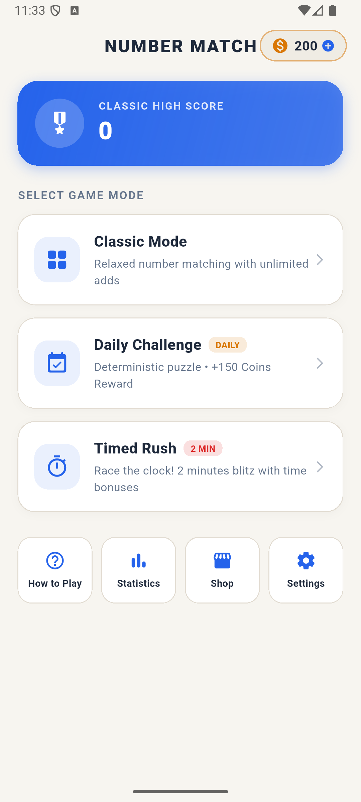
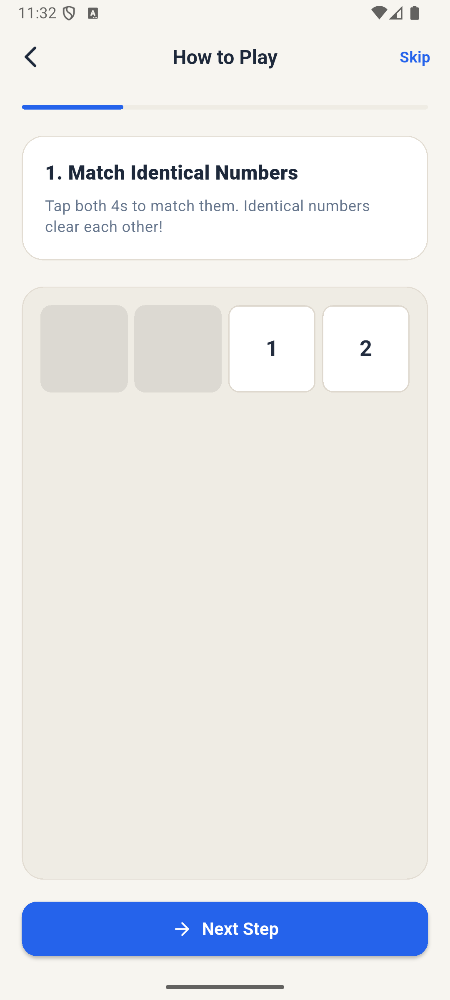
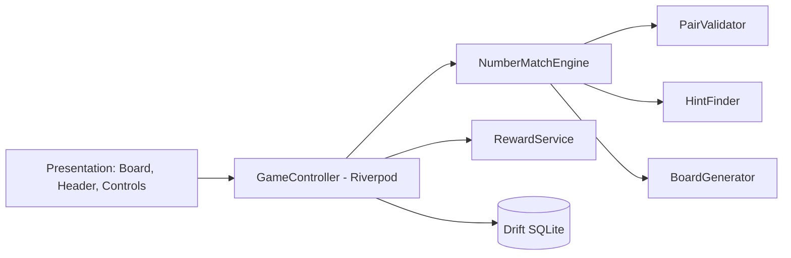

# Number Match — Oyun Rehberi

> **English version:** [GAME_GUIDE.en.md](GAME_GUIDE.en.md)


Bu belge oyunun **nasıl oynandığını, nasıl çalıştığını (mantığını), modlarını, puanlama/ekonomi kurallarını ve nasıl çalıştırılacağını** anlatır. Teknik özet için [README.md](../README.md), kesin kural şartnamesi için [GAME_RULES.md](GAME_RULES.md), mimari için [ARCHITECTURE.md](ARCHITECTURE.md) dosyalarına bakın.

> Değerler kaynak koddan alınmıştır (`lib/core/constants/game_constants.dart`, `lib/domain/engine/*`).

---

## 1. Oyun nedir?

Number Match, **9 sütunlu** bir sayı tablosunda (1–9 arası rakamlar) eşleşen sayı çiftlerini silerek tabloyu tamamen temizlemeye çalıştığınız bir mantık/bulmaca oyunudur. Flutter ile yazılmış, Android/iOS hedefli, internetsiz (offline-first) çalışan bir mobil oyundur.

**Amaç:** Tablodaki tüm sayıları silmek (zafer) ve mümkün olduğunca yüksek puan/kombo yapmak.

---

## 2. Nasıl oynanır?

### 2.1 Eşleşme kuralı
İki hücre şu durumlardan **biri** doğruysa eşleşir:

| Kural | Örnek |
| :-- | :-- |
| Sayılar **aynı** | 3–3, 7–7, 9–9 |
| Sayıların **toplamı 10** | 1–9, 2–8, 3–7, 4–6, 5–5 |

Bir hücre kendisiyle eşleşemez; silinmiş hücre seçilemez.

### 2.2 Konum (görüş hattı) kuralı
Eşleşen iki hücre aşağıdakilerden **en az birini** sağlamalı; aradaki tüm hücreler **boş (silinmiş)** olmalıdır:

1. **Okuma sırasıyla ardışık:** Soldan sağa, yukarıdan aşağıya okuduğunuzda yan yana gelen iki dolu hücre. Satır sonu → sonraki satır başı da geçerlidir (satır atlayarak).
2. **Aynı satır:** Arada dolu hücre yoksa.
3. **Aynı sütun:** Arada dolu hücre yoksa.
4. **Çapraz (45°):** Köşegen üstünde ve arada dolu hücre yoksa.

### 2.3 Adım adım bir hamle
1. Bir sayıya dokunun (seçilir, vurgulanır).
2. Eşleştirmek istediğiniz ikinci sayıya dokunun.
3. Geçerliyse ikisi de **silinir**, puan + kombo kazanırsınız.
4. Geçersizse hata geri bildirimi (titreşim) alırsınız ve **kombo 1×'e düşer**.





### 2.4 "Add Numbers" (Sayı Ekle)
Hamleniz kalmadığında **Add Numbers**'a basın. Tabloda **kalan tüm sayılar sırasıyla kopyalanır** ve tablonun sonuna eklenir. Kombo 1×'e sıfırlanır. Bu, yeni eşleşme fırsatları açar — ama tablo uzar, bu yüzden akıllıca kullanın.

### 2.5 Satır temizleme (compaction)
Klasik modda bir satırın 9 hücresi de silinirse satır **çöker**: alttaki satırlar yukarı kayar, okuma sırası korunur. Satır temizleme bonus puan ve coin verir.

### 2.6 Geri Al ve İpucu
- **Undo:** Son hamleyi geri alır (tahta, puan, kombo, eşleşme sayısı eski haline döner).
- **Hint:** Tahtadaki ilk geçerli çifti gösterir. **50 coin** harcar. Hamle yoksa "Add Numbers kullanın" uyarısı verir.

---

## 3. Oyun modları

| Mod | Açıklama |
| :-- | :-- |
| **Classic** | Süresiz, rahat oyun. Başlangıç tablosu 27 hücre. Oyun otomatik kaydedilir, kaldığınız yerden devam edersiniz. Zafer: +75 coin. |
| **Daily Challenge** | Tarihe göre üretilen (seed'li) bulmaca; o gün **tüm oyuncularda aynıdır**. 36 hücre ile başlar. Zafer: **+150 coin**. Takvim ekranından gün durumları görülür. |
| **Timed Rush** | **2 dakikalık** hızlı mod. Her eşleşme **+3 sn**, her satır temizleme **+10 sn** ekler. Süre bitince oyun biter. |

---

## 4. Puanlama, kombo ve ödüller

| Eylem | Puan | Coin |
| :-- | :-- | :-- |
| Aynı sayı eşleşmesi | 10 × kombo | — |
| Toplamı 10 eşleşmesi | 15 × kombo | — |
| Her 5 eşleşme (milestone) | — | +5 |
| Satır temizleme | 50 | +10 |
| Tahtayı temizleme (zafer) | 1.000 | +75 (Classic/Timed), +150 (Daily) |

**Kombo:** Hatasız ardışık her eşleşme çarpanı 1 artırır, **en fazla 10×**. Geçersiz dokunuş veya Add Numbers çarpanı sıfırlar.

**Ekonomi:** Başlangıçta 200 coin. Rewarded reklam +100 coin verir. Coin ve ipucu harcamaları yerel SQLite'ta tutulur.

**İpucu stratejisi:**
- Önce toplamı-10 eşleşmelerini ve çapraz/sütun fırsatlarını arayın; satır silmek oyunu kısaltır.
- Add Numbers'ı mümkün olduğunca geciktirin ama kilitlenmeyin.
- Kombo için hata yapmadan seri eşleşme yapın.

---

## 5. Oyun nasıl çalışıyor? (Mantık / mimari)



- **`BoardGenerator`**: Başlangıç tahtasını üretir (Daily'de tarih seed'iyle deterministik).
- **`PairValidator`**: Değer kuralı (eşit / toplam 10) + konum kuralı (ardışık, satır, sütun, çapraz, arada boşluk).
- **`NumberMatchEngine`**: Saf Dart durum makinesi; eşleştirme, Add Numbers, satır çöktürme, skor/kombo, undo yığını.
- **`HintFinder`**: İlk geçerli çifti tarar.
- **`GameController`**: UI ↔ motor köprüsü; oturumu SQLite'a JSON olarak yazar.
- **`RewardService`**: Tüm coin giriş/çıkışları.
- **Ses/Haptik**: `AudioFeedbackService`, `HapticFeedbackService`.
- **Katmanlar:** `domain` → `application` → `data` → `presentation`.

---

## 6. Ekranlar

Splash → Home → (Classic / Daily / Timed Rush) → Game → Results diyaloğu. Ayrıca: **Tutorial** ("How to Play", Add Numbers simülasyonu dahil), **Stats**, **Shop**, **Settings**.

---

## 7. Ayarlar ve erişilebilirlik

- **4 tema:** Classic Paper, Midnight (OLED), Ocean, High Contrast (WCAG AAA); sistem açık/koyu modu ile senkron.
- Reduced motion, metin ölçeği (0.85×–1.30×), haptik ve ses anahtarları, analitik tercihi.
- Minimum 44 px dokunma hedefleri.

---

## 8. Monetizasyon

- **Ads Free (ömür boyu)**: `com.numbermatch.game.ads_free` (non-consumable, ~2.99 USD). Reklamları kaldırır, rewarded ödülleri izlemeden verir.
- **Interstitial**: Sadece doğal geçişlerde (oyun sonu/menüye dönüş), en az **120 sn** aralıkla; oyun sırasında asla.
- Üretim için sunucu doğrulama ve gerçek AdMob bağlama adımları: [MONETIZATION_SETUP.md](MONETIZATION_SETUP.md). Varsayılan olarak **mock/sandbox** sağlayıcılar kullanılır.

---

## 9. Kurulum ve çalıştırma

**Gereksinimler:** Flutter SDK (Dart `^3.13.4`), Android Studio veya Xcode, git erişimi.

```bash
git clone https://github.com/denogames/number-match.git
cd number-match
flutter pub get
flutter run            # bağlı cihaz/emülatör
flutter test           # testler
flutter build apk --release        # Android
flutter build ios --release        # iOS (macOS gerekir)
```

> Not: `pubspec.yaml`, `studio_core_sdk` paketini GitHub'dan (`denogames/studio-core-sdk`, ref `feat/offline-core-hardening-v1`) çeker. Bu repoya erişiminiz olmalı. Offline SDK kasası ilerlemenizi (progression) cihazda saklar.

**Testler:** `test/engine` (üretici, doğrulayıcı, motor), `test/persistence`, `test/monetization`, `test/widgets`, `test/studio_sdk_integration_test.dart`.

---

## 10. Sorun giderme

| Sorun | Çözüm |
| :-- | :-- |
| `flutter pub get` SDK paketini bulamıyor | GitHub erişimi/SSH-HTTPS kimlik bilgilerini kontrol edin; ref dalının var olduğunu doğrulayın |
| Drift kod hatası | `dart run build_runner build --delete-conflicting-outputs` |
| Hamle "geçersiz" | Arada dolu hücre var mı? Değerler eşit/toplam 10 mu? |
| Hamle kalmadı | **Add Numbers** kullanın |

---

## 11. Yol haritası (özet)
[POST_MVP_ROADMAP.md](POST_MVP_ROADMAP.md): haftalık turnuvalar, mevsimsel temalar, kozmetik tile setleri, bomb/swap booster'lar, Zen/Master modları, bulut senkronizasyonu, arkadaş sıralamaları.
